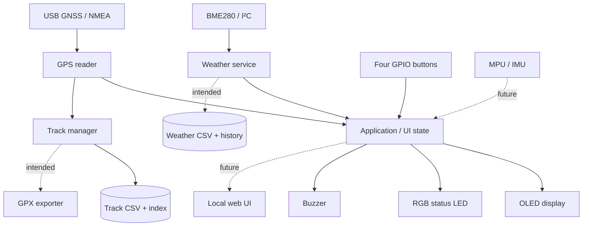

# SailSense

**An open-source, Raspberry Pi–based sailing companion for GPS track recording and local weather observations.**

*A small instrument for the cockpit, a logbook for the voyage, and a playground for embedded software and electronics.*

**Languages:** [English](#english) · [Deutsch](#deutsch)

**Project status:** Experimental prototype / work in progress · **Hardware:** Raspberry Pi Zero 2 W · **Software:** Python · **License:** [MIT](LICENSE)

> [!IMPORTANT]
> **Development prototype, not a certified marine instrument.** SailSense must not be used as the sole means of navigation, position monitoring, anchor-watch supervision, or emergency warning. Use appropriate charts, instruments, seamanship, and independent backups.
>
> **Repository completeness:** The published `main` branch inspected on **1 November 2026** is not yet a reproducible, ready-to-run software release. Some modules imported by `src/sailsense/app.py` are missing from the public checkout, while `src/sailsense/display/oled_display.py` and `src/sailsense/export/gpx_exporter.py` are empty placeholders. The running Raspberry Pi may contain a more complete local version. See [Known issues](#known-issues-and-limitations) and [P0 — Establish a reproducible baseline](#p0--establish-a-reproducible-baseline). These notes describe the published source, not the outcome of a fresh hardware test.

---

<a id="english"></a>
# English

## 1. Overview

SailSense is a compact, DIY instrument designed for sailing trips, particularly when a simple, independent record of a voyage is more useful than another large multifunction display. A Raspberry Pi Zero 2 W combines a USB GNSS receiver, a BME280 environmental sensor, an OLED display, buttons, an RGB status LED, and an optional acoustic signaler in a custom 3D-printed enclosure.

The project is intended to:

- **Record a voyage:** save GPS positions, time, speed, course, distance, and manually placed event markers.
- **Observe onboard weather:** measure temperature, relative humidity, and atmospheric pressure; retain historical values and visualize pressure trends.
- **Keep data portable:** use CSV files as a transparent primary format and provide a GPX export workflow for tracks.
- **Work without cloud services:** operate locally on the Raspberry Pi; SSH is available for maintenance.
- **Remain hackable:** expose hardware, settings, and algorithms for experimentation, repair, and improvement.

The design is deliberately modest: useful measurements, dependable logging, low consumption, and as few dependencies as practicable. A smartphone-based local web interface is under consideration as an alternative to the current button-and-OLED approach.

### Scope and non-goals

SailSense is a **supplementary logger and information display**, not a chartplotter replacement, AIS receiver, autopilot, certified barometer, calibrated weather station, or safety-critical alarm. In particular, the planned anchor watch must not be relied upon until extensively tested under real conditions.

## 2. Features and implementation status

The table distinguishes **code present** from **end-to-end functionality verified on the published branch**. A function being referenced by an application file does not mean that the current checkout can execute it.

| Feature | Status in the published repository | Notes |
|---|---|---|
| GNSS/NMEA data acquisition | **Core code present** | `GPSReader` parses valid RMC positions and supplements them with GGA information. |
| Position, speed, course and satellite information | **Core code present** | Coordinates, knots, course over ground, altitude, satellites, fix quality and HDOP. |
| Manual track sessions | **Core code present** | Start/stop, sampling interval, point-quality gates and distance accumulation. |
| Event markers | **Core code present** | A marker is attached to the next accepted track point. |
| Track list, details and miniature map | **UI flow present; display backend incomplete** | Application callbacks exist, but the public OLED module is empty. |
| CSV track files and track index | **Track-writing code present; some referenced helpers absent** | Track CSV schema is defined in `gps/track_manager.py`. |
| GPX export | **Integration hook present; exporter incomplete** | Export is called on track stop, but the published exporter is empty. |
| BME280 weather acquisition and aggregation | **Configured / app integration present; modules missing** | Intended 10-second reads, 60-second display average, 15-minute archival samples. |
| Barograph and historical graph | **Configured / UI call present; incomplete** | 24-hour reference and scaling parameters exist; published render implementation is missing. |
| Four-button menu | **Controller code present** | UP, DOWN, OK and BACK with pull-ups and debouncing. |
| RGB LED indications | **Driver code present** | Startup, idle heartbeat, recording, marker and error feedback. |
| Passive/active buzzer | **Driver code present** | Non-blocking sound patterns for actions and warnings. |
| OLED auto-sleep / wake on button | **Application flow present; hardware integration unverified here** | Sleep timeout configurable. |
| Shutdown / restart menu | **Application flow present; supporting power module absent** | Requires suitable operating-system permissions. |
| MPU6050/MPU9250 integration | **Not integrated** | IMU is disabled in the example configuration. |
| Anchor watch | **Configuration present; integration not verified** | Do not treat as operational safety equipment. |
| White/red flashlight mode | **Configuration/prototype work; not wired into public `app.py`** | Intended LED-based utility mode, not a substitute for a proper torch. |
| Phone browser / web server | **Planned** | Local dashboard and controls are a design option. |
| Power optimization and battery monitoring | **Planned** | Requires measured, hardware-specific validation. |

## 3. Hardware

### Main components

| Component | Purpose / remarks |
|---|---|
| Raspberry Pi Zero 2 W | Linux host, Python runtime, logging, user interface and Wi-Fi. |
| USB GNSS receiver (u-blox 7 in the tested setup) | NMEA position and time source; `/dev/ttyACM0` at 9,600 baud in the current configuration. |
| Bosch BME280 | Ambient temperature, relative humidity and **local station pressure**, connected via I²C. |
| Monochrome I²C OLED | Compact status interface; published settings target **SSD1306-compatible 128 × 64**, address `0x3C`. |
| Four momentary switches | UP, DOWN, OK, BACK; physical positioning still needs redesign. |
| RGB LED | State indication and possible white/red utility light; configured as common anode. |
| Piezo buzzer | Optional audible feedback and warning patterns; passive type configured. |
| Custom 3D-printed enclosure | Protects and organizes the electronics; mechanical revisions pending. |
| Optional RTC and MPU module | Hardware explored during prototyping; not confirmed as functioning app components in the public branch. |

> [!NOTE]
> A **128 × 128 SH1107 OLED** was also evaluated during hardware development. This is **not** the display targeted by the current `settings.yaml`. Intermittent I²C detection and level-shifter trouble were observed during the changeover. Do not assume the SSD1306 and SH1107 configurations are interchangeable.

### Pin and interface reference

These are **BCM GPIO numbers**, *not* physical header pin numbers. Values are taken from `config/settings.yaml`, not from a verified wiring diagram.

| Peripheral | Interface / BCM GPIO | Configured value |
|---|---|---|
| GPS receiver | USB serial | `/dev/ttyACM0`, 9600 baud |
| BME280 | I²C bus 1 | `0x76` (decimal 118) |
| OLED | I²C bus 1 | `0x3C` (decimal 60), 128 × 64 |
| IMU (planned) | I²C bus 1 | `0x68` (decimal 104), currently disabled |
| UP | GPIO17 | Button to GND, internal pull-up |
| DOWN | GPIO27 | Button to GND, internal pull-up |
| OK | GPIO22 | Button to GND, internal pull-up |
| BACK | GPIO23 | Button to GND, internal pull-up |
| Red LED channel | GPIO5 | PWM output; current limiting required |
| Green LED channel | GPIO6 | PWM output; current limiting required |
| Blue LED channel | GPIO13 | PWM output; current limiting required |
| Buzzer | GPIO12 | Passive PWM buzzer configured |

**Electrical precautions:** The Pi GPIO and I²C logic operate at **3.3 V** and are **not 5 V tolerant**. Check the actual breakout-board voltage requirements, pull-up resistors, and level-shifter direction before connecting anything. Give **each LED colour channel a suitable current-limiting resistor**; software brightness control is not current protection. Use a clean common ground, strain relief, and appropriately insulated wiring. Avoid directly exposing electronics or the BME280 board to salt spray or condensation.

### Power budget and electrical supply

A previous prototype measurement was approximately **200 mA at 5 V** while operating (roughly **1 W**). This is an observation from one build, **not** a guaranteed specification. At that draw, a continuously running logger would require about **24 Wh per day** or **168 Wh over seven days**, before conversion losses and power-bank overhead. The actual result depends on GPS, Wi-Fi, OLED brightness/duty cycle, CPU activity and the power supply. On a boat, use a **regulated 5 V supply**, allow for startup/current peaks and assess electrical noise and undervoltage before relying on multi-day logging.

For the next revision, compare current draw with the display on/off, Wi-Fi active/inactive, idle versus active recording, and individual peripherals disabled. Do not pursue a lower power figure at the price of missed track points or corrupted files.

### BME280 placement matters

The sensor must exchange air with its surroundings while remaining protected from splashes, direct sunlight and radiant heat from the Pi or its power circuitry. An enclosed BME280 may read the **temperature of the enclosure**, not the outside air. The planned redesign should include a ventilated, splash-shielded holder separated from internal heat sources. Pressure is measured at sensor altitude; **sea-level pressure (QNH-like normalization) requires a separate calculation and assumptions**.

## 4. Software architecture

SailSense is written in Python and follows a modular, local-first architecture. The application coordinates sensor readers, state, logging, display rendering, controls, and output signals.



*Dashed lines indicate a planned or currently incomplete integration in the public checkout, not guaranteed runtime behavior.*

### Source layout

The following is a **logical guide**, including entries referenced in the source. It is **not a claim that every listed module exists or contains working code in `main`**.

```text
SailSense/
├── README.md
├── LICENSE
├── config/
│   └── settings.yaml
├── scripts/
│   └── run_app.sh
├── old_tests/
└── src/
    └── sailsense/
        ├── app.py                     # Main loop, state and button actions
        ├── config.py                  # Reads ~/sailsense/config/settings.yaml
        ├── gps/
        │   ├── gps_reader.py          # NMEA RMC/GGA decoding
        │   └── track_manager.py       # Manual track recording, CSV schema
        ├── weather/                   # BME reader/service/history (incomplete in main)
        ├── display/
        │   └── oled_display.py        # Present as empty placeholder in main
        ├── input/
        │   └── buttons.py             # GPIO switch handling
        ├── output/
        │   ├── status_led.py          # RGB PWM driver
        │   └── buzzer.py              # Asynchronous audio patterns
        ├── storage/                   # CSV, track index and point loaders (gaps)
        ├── export/
        │   └── gpx_exporter.py        # Present as empty placeholder in main
        ├── system/                    # Power actions referenced by app (gap)
        └── imu/                       # Future inertial sensing
```

### Main loop and controls

The published `app.py` declares the pages `Status`, `GPS`, `Wetter` (weather), `Baro`, `Logging`, `Tracks`, and `System`. UP/DOWN navigate, OK enters context-specific actions, and BACK returns or opens the confirmation to stop an active track. The first button press after display sleep only wakes the OLED; it does not trigger the underlying action.

| Page | Intended purpose / current application logic |
|---|---|
| Status | Satellite count/fix, speed, latest weather, weather-history counter. |
| GPS | Latitude, longitude, speed-related information, altitude, HDOP. |
| Wetter | Rolling average of temperature, humidity and pressure; sample count. |
| Baro | Graphical atmospheric-pressure history (display backend must be restored). |
| Logging | Manually start/stop a track; OK adds a marker during recording. |
| Tracks | Browse saved sessions and request a small track plot. |
| System | Information, restart and safe-shutdown confirmation. |

The published source does **not** currently connect an interactive flashlight page, an anchor-watch page, or editable barograph settings to the main button dispatch, even though the configuration contains parameters for these features.

## 5. Recording and data formats

### GPS acquisition

`gps_reader.py` reads NMEA sentences from a serial receiver. A valid RMC sentence yields a position with a **UTC timestamp**, latitude/longitude, speed in knots and km/h, and course over ground. GGA values are cached for altitude, satellite count, fix quality and HDOP. Invalid RMC positions are ignored.

### Track sessions

The manual `TrackManager` is configured to store **at most one accepted point every 5 seconds**. It requires **at least five satellites** and normally **HDOP ≤ 5.0** when HDOP is reported. A single jump greater than **500 m** compared with the preceding accepted point is rejected. Distance is accumulated between accepted coordinates and reported in metres, kilometres and nautical miles.

A new recording creates a dedicated CSV file. On an orderly stop, its summary is appended to the track index. An event marker is stored with the **next accepted point**, so a marker might be delayed or lost if there is no subsequent valid fix.

**Track CSV fields as defined in source:**

```text
track_id, timestamp_utc, lat, lon, speed_kn, speed_kmh,
course_deg, alt_m, sats, fix_quality, hdop,
distance_from_previous_m, distance_total_m, distance_total_nm, marker
```

### Weather acquisition and barograph

The configuration describes a three-stage pipeline:

1. **Raw measurement:** BME280 reading approximately every **10 seconds**.
2. **Display value:** aggregate readings over a **60-second window** to avoid a nervous, misleading graph.
3. **Historical storage:** write one summary approximately every **15 minutes**; keep up to **96 points** for a nominal 24-hour display.

Configured barograph options include a **rolling 24-hour mean** as the reference line, a **manual 1013.0 hPa reference**, a starting vertical scale of **0.25 hPa per pixel**, and 1/3/24-hour pressure differences. The settings are present, but full interactive operation cannot be confirmed from the published OLED/UI modules. Avoid treating a pressure trend or humidity measurement as a weather forecast without additional context.

### File locations

Paths below are from the example configuration. They assume Linux user `user` and the project directory `/home/user/sailsense`.

| Content | Configured path / example |
|---|---|
| Project configuration | `/home/user/sailsense/config/settings.yaml` |
| Weather CSV | `/home/user/sailsense/logs/weather/` |
| Individual GPS tracks | `/home/user/sailsense/logs/tracks/` |
| Track index | `/home/user/sailsense/logs/tracks/tracks_index.csv` |
| Intended GPX exports | `/home/user/sailsense/data/exports/` |
| Systemd journal | `journalctl -u sailsense.service` |

CSV is appropriate for analysis with Python, LibreOffice, or Excel. GPX is intended for track exchange with mapping applications. **Do not assume GPX export works in the currently published repository**, where the exporter file is empty. Do not commit personal voyage logs: GPX/CSV can disclose exact movements and mooring locations.

## 6. Installation and deployment

> [!WARNING]
> The instructions below document the **intended Raspberry Pi deployment**. They are **not** a tested one-command installation of the current public branch. Restore missing modules and create an accurate dependency manifest first; see the P0 tasks.

### Prerequisites

- Raspberry Pi Zero 2 W with an appropriate Raspberry Pi OS installation, functional 5 V power and network or SSH access.
- Correctly wired I²C peripherals, compatible GNSS receiver and GPIO components.
- Python 3 with virtual-environment support; Git and I²C utilities.
- Permission to access serial, I²C and GPIO interfaces.

On Raspberry Pi OS:

```bash
sudo apt update
sudo apt install -y git python3 python3-venv python3-pip i2c-tools
sudo raspi-config
# Enable I2C under Interface Options if it is not enabled already.
```

Clone into the path currently expected by `config.py` and `run_app.sh`:

```bash
cd /home/user
git clone https://github.com/lo0pin/SailSense.git sailsense
cd sailsense
python3 -m venv .venv
source .venv/bin/activate
```

**Dependencies:** The public repository does not currently provide a verified installation manifest. Imports in available modules establish a minimum need for packages such as `pyserial`, `pynmea2`, `PyYAML`, and `gpiozero`. BME280/OLED drivers and other dependencies must be determined from the **restored source**. Do **not** mistake the following for a complete installation:

```bash
python -m pip install pyserial pynmea2 PyYAML gpiozero
# Once the missing drivers/modules have been restored:
# python -m pip install -r requirements.txt
```

Edit `config/settings.yaml` for your serial device, I²C addresses, display model, GPIO layout, and output directories. The current `config.py` fixes the project root at `~/sailsense`, and the launcher fixes it at `/home/user/sailsense`; using a different account/path requires adapting both.

### Start from the command line

```bash
cd /home/user/sailsense
source .venv/bin/activate
PYTHONPATH=src python -m sailsense.app
# Alternatively, once restored:
bash scripts/run_app.sh
```

For a **shorter weather storage interval while testing**:

```bash
SAILSENSE_WEATHER_STORAGE_INTERVAL=60 PYTHONPATH=src python -m sailsense.app
```

The environment variable is expressed in **seconds**, overrides the normal archive interval, and is intended for tests rather than routine voyage records.

### Run as a systemd service

A deployment service named `sailsense.service` has been used on the Raspberry Pi. Its unit file is **not included in the inspected repository**. The following is a **sample template**, not a file guaranteed to exist:

```ini
# /etc/systemd/system/sailsense.service
[Unit]
Description=SailSense GPS and weather logger
After=multi-user.target

[Service]
Type=simple
User=user
WorkingDirectory=/home/user/sailsense
Environment=PYTHONPATH=/home/user/sailsense/src
ExecStart=/home/user/sailsense/.venv/bin/python -m sailsense.app
Restart=on-failure
RestartSec=5

[Install]
WantedBy=multi-user.target
```

After saving and adapting the unit:

```bash
sudo systemctl daemon-reload
sudo systemctl enable --now sailsense.service
systemctl status sailsense.service
journalctl -u sailsense.service -n 100 --no-pager
journalctl -u sailsense.service -f
sudo systemctl restart sailsense.service
sudo systemctl stop sailsense.service
```

The application may require additional permissions for **system shutdown/restart**; configure this explicitly and conservatively instead of running the entire application as root. Avoid simultaneously launching a manual instance and the service: both could compete for the same serial port, GPIOs and output files.

## 7. Operation and diagnostics

### First-run checklist

1. Confirm a stable 5 V supply and inspect wiring, fuses/current-limiting resistors and common ground.
2. Check I²C with `sudo i2cdetect -y 1` and verify the **actual** addresses.
3. Identify the GPS with `ls -l /dev/ttyACM* /dev/ttyUSB* 2>/dev/null` and `dmesg | tail -n 40`.
4. Confirm the receiver has a real sky view and obtains a valid GNSS fix. A cold start can take longer than a warm start.
5. Test buttons, OLED, LED and buzzer individually before enabling the combined application.
6. Restore/check all imported Python modules and use the terminal start command before enabling autostart.
7. Start and stop a short track. Check the CSV header, timestamps, coordinates, distance, index row and GPX output, if available.
8. Reboot and verify that history loading, file permissions and the service behave as expected.

Useful diagnostics:

```bash
hostname -I
ls -l /dev/i2c-* /dev/ttyACM* /dev/ttyUSB* 2>/dev/null
sudo i2cdetect -y 1
systemctl status sailsense.service
journalctl -u sailsense.service --since '1 hour ago' --no-pager
find /home/user/sailsense/logs -type f -printf '%TY-%Tm-%Td %TH:%TM %p\n' | sort
```

For transfer to a different computer (PowerShell example):

```powershell
scp -r user@sailsense.local:/home/user/sailsense/logs "$HOME\Downloads\SailSense-logs"
```

If `sailsense.local` cannot be resolved, use the Pi's **verified current IP address**. If a Windows card reader only exposes the small boot partition of the Pi's SD card, that is expected: the Linux data partition normally uses **ext4**, which Windows does not natively mount. SSH/SCP or a Linux machine is usually the less invasive route. Always shut down the Pi before removing its card.

### Troubleshooting guide

| Symptom | What to check first |
|---|---|
| `ModuleNotFoundError` / `ImportError` | Missing modules in `main`, incorrect virtual environment or `PYTHONPATH`; restore the source before changing dependencies blindly. |
| No GPS fix or satellites | Sky visibility, cold/warm start, USB power, NMEA output and current serial device. No fix is not proof of a dead receiver. |
| `/dev/ttyACM0` missing | `lsusb`, `dmesg`, cable/adapter, current port; plan a stable udev symlink. |
| `i2cdetect` cannot see BME280/OLED | Supply voltage, ground, SDA/SCL, address, pull-ups, level shifting and faulty connections. |
| OLED replaced with SH1107 | Requires the correct driver/dimensions, not merely a new I²C address. |
| Weather temperature too high | Pi heat, solar radiation, low ventilation, sensor positioning and averaging window. |
| Barograph looks noisy | Sampling, outliers, real pressure change, display scale and correct reference mode. |
| Empty/short track | GPS quality gate, satellites/HDOP, sampling interval, invalid RMC or abrupt stop. |
| Service keeps restarting | `journalctl`; missing dependency/peripheral, permission conflict or incomplete checkout. |
| No access by SSH | Wi-Fi association, host name resolution, IP address, power, SSH activation and port 22. |
| Data missing after outage | Unflushed/incomplete session, card or filesystem errors; implement recovery and backups. |

## 8. Known issues and limitations

These are tracked engineering concerns; not all have been isolated to a single reproducible software defect.

| ID | Issue | Priority | What needs to change |
|---|---|---|---|
| **KI-01** | **Public repository incomplete** | **P0** | Restore missing weather, display, storage, power and export modules; remove empty placeholders; provide dependencies and a clean-install check. |
| **KI-02** | **Button positions / enclosure ergonomics** | **P1** | Redesign the 3D-print model, improve tactile spacing and accessibility with wet or gloved hands; decide whether physical controls remain necessary if a web UI is added. |
| **KI-03** | **BME280 ventilation grille / mount** | **P1** | Redesign the sensor holder for airflow, heat isolation, mechanical retention and splash protection. |
| **KI-04** | **MPU integration pending** | **P2** | Select and validate the actual MPU6050/MPU9250 hardware and integrate calibrated motion readings only where useful. |
| **KI-05** | **Power consumption not optimized** | **P1** | Profile Pi, GPS, OLED, Wi-Fi, LED and buzzer loads across modes; improve efficiency without sacrificing recording integrity. |
| **KI-06** | **No local web server/mobile UI** | **P1** | Implement an optional responsive LAN interface or decide on a headless-first architecture. |
| **KI-07** | **OLED / I²C hardware compatibility** | **P1** | Reconcile SSD1306 vs SH1107, driver selection, voltage levels, pull-ups and the level-shifter problem. |
| **KI-08** | **Incomplete integration of configured features** | **P1** | Verify barograph settings, flashlight mode, anchor watch and enable flags against actual runtime code. |
| **KI-09** | **Track interruption and crash recovery** | **P1** | Preserve recoverable incomplete sessions, avoid losing metadata on an unclean shutdown, and test export after interruption. |
| **KI-10** | **GPS device naming and reconnect behavior** | **P1** | Stable `/dev/serial/by-id/...` or udev alias, unplug/replug handling, timeout/reconnect and visible stale-data warnings. |
| **KI-11** | **Power-loss resilience / SD-card wear** | **P1** | Brownout detection, clean shutdown, write-rate review, atomic metadata writes and backup strategy. |
| **KI-12** | **GPS outlier filtering is basic** | **P2** | Add speed/acceleration plausibility and dead-zone handling; validate the 500 m filter for sailing use. |
| **KI-13** | **Sensor calibration and exposure** | **P2** | Quantify heat bias, pressure offset, humidity drift and the limitations of a BME280 in a sealed enclosure. |
| **KI-14** | **Weather/track timestamps and exports** | **P2** | Define UTC conventions, date formatting, CSV schema versions and lossless GPX behavior. |
| **KI-15** | **Missing automated tests/CI/documentation** | **P1** | Unit tests with simulated sensor input, hardware-in-the-loop checklist, wiring diagram, bill of materials and release procedure. |
| **KI-16** | **Marine environment durability** | **P2** | Splash resistance, salt corrosion, condensation management, cable relief and serviceability. |
| **KI-17** | **Anchor-watch reliability not established** | **P1 / safety** | Implement and test false-alarm limits, GPS accuracy, hysteresis, continuous audible alerts and safe failure behavior. |
| **KI-18** | **Data privacy and local network security** | **P1 before web release** | Keep track logs private; authenticated controls, no unprotected Internet exposure, permissions and backup/export policy. |

## 9. Roadmap / TODO

### P0 — Establish a reproducible baseline

- [ ] Copy the **authoritative, currently working** source tree from the Raspberry Pi; compare it with GitHub before overwriting anything.
- [ ] Restore missing modules and resolve all imports (`python -m sailsense.app` must at least import successfully).
- [ ] Replace empty OLED and GPX placeholder files with their real implementations, or explicitly remove unavailable features.
- [ ] Add a curated `requirements.txt` or `pyproject.toml` and supported Python/Raspberry Pi OS versions.
- [ ] Add `.gitignore` for `.venv/`, `__pycache__/`, logs, GPX/CSV exports, local secrets and build artefacts.
- [ ] Add a reproducible `systemd` unit and installation instructions; test on a clean SD-card image.
- [ ] Tag an initial documented version and distinguish tested hardware combinations.

### P1 — Make it dependable on board

- [ ] Choose the interface architecture: **OLED + four buttons**, **web-first/headless**, or **hybrid** with a minimal hardware fallback.
- [ ] Redesign the **3D-printed button layout** or eliminate unnecessary buttons if the hybrid/web route is chosen.
- [ ] Redesign the **BME280 grille and sensor mounting** with airflow, heat separation and splash shielding.
- [ ] Fix OLED/I²C compatibility; confirm the final screen model and bus topology.
- [ ] Profile actual current draw in idle, recording, screen-on, Wi-Fi and warning states; set a measurable energy target.
- [ ] Add a local-only **web server and mobile-first dashboard** for GPS, tracks, weather and basic controls; work without an Internet connection.
- [ ] Evaluate Wi-Fi client mode versus a Raspberry Pi access point; handle offline/no-phone scenarios.
- [ ] Implement power-safe track recovery, status after reboot and a watchdog/health check.
- [ ] Implement resilient GNSS reconnects, a stable device path and clear “no current fix” indications.
- [ ] Verify configurable barograph reference/vertical zoom in the integrated UI.
- [ ] Verify red/white LED flashlight behavior and priority against warnings and other LED states.
- [ ] Review anchor-watch logic separately as a safety-sensitive feature; test it before enabling or advertising it.
- [ ] Establish unit tests, sample NMEA streams, example weather histories and continuous integration.

### P2 — Expand and refine

- [ ] Integrate the **MPU** only after defining a useful purpose (pitch/roll, motion statistics, sensor correction); calibrate and account for vessel movement.
- [ ] Improve positioning filters, log quality metrics and make GPS outages visible in exported tracks.
- [ ] Provide CSV/GPX downloads through the web interface, with explicit export formats and no silent data loss.
- [ ] Add sensor calibration tools and barometer normalization options with clearly labelled pressure types.
- [ ] Evaluate automatic trip detection, track splitting by day, session names and human-readable markers.
- [ ] Add battery/undervoltage monitoring and optional battery-runtime estimation.
- [ ] Prototype an enclosure revision with gaskets, proper cable passages, mounting points and service access.
- [ ] Publish 3D print files, wiring schematic, BOM, photographs, benchmarks and a short demonstration.
- [ ] Improve internationalization, accessibility, documentation, versioning and contribution workflow.

### Web-first or hybrid? A deliberate design decision

A **headless, phone-operated device** can simplify the enclosure, remove a display and four buttons, and provide much better graphs. It also introduces new dependencies: phone availability, Wi-Fi reliability, startup/discovery, authentication, browser compatibility, and battery use. A **hybrid design** might retain one waterproof physical control, a small state LED and/or a buzzer for essential feedback while moving configuration, analysis and track downloads to the browser. Whatever architecture is chosen, **recording must continue when the phone disconnects**. The web UI must be a client of the logger, not the logger's reason to exist.

## 10. Contribution, data and license

Bug reports and contributions should include: Pi model and OS, firmware/commit, hardware revision, sensor/display types, redacted configuration, reproduction steps, relevant journal excerpts and expected versus observed behavior. Never publish personal coordinates, Wi-Fi credentials, private keys or an unredacted voyage log by accident.

SailSense is released under the **[MIT License](LICENSE)**. Hardware schematics and printable enclosure files, if published later, should have their licensing clarified separately.

---

<a id="deutsch"></a>
# Deutsch

## 1. Projektbeschreibung

**SailSense** ist ein kompaktes, selbst entwickeltes Mess- und Aufzeichnungsgerät für Segeltörns. Auf Basis eines **Raspberry Pi Zero 2 W** vereint es GPS-Positionserfassung, Wetterbeobachtung und eine einfache lokale Bedienoberfläche. Ziel ist ein kleiner, unabhängiger Begleiter an Bord: Er zeichnet die zurückgelegte Route auf, sammelt meteorologische Messwerte und macht die Daten für spätere Auswertungen zugänglich.

Als Hardware sind ein USB-GNSS-Empfänger, der **BME280**, ein OLED-Display, vier Taster, eine RGB-LED und ein Summer vorgesehen beziehungsweise prototypisch erprobt. Die Elektronik befindet sich in einem individuell konstruierten **3D-gedruckten Gehäuse**, das weiterentwickelt wird.

### Projektziele

- **Törns dokumentieren:** Position, UTC-Zeit, Geschwindigkeit, Kurs, Strecke und manuell gesetzte Ereignismarker erfassen.
- **Wetter beobachten:** Temperatur, Luftfeuchtigkeit und Luftdruck messen, verdichten, speichern und als zeitliche Entwicklung darstellen.
- **Offene Formate verwenden:** Daten in CSV ablegen und GPS-Tracks perspektivisch als GPX exportieren.
- **Offline funktionieren:** Aufzeichnung und Auswertung sollen ohne Cloud und ohne Internetverbindung möglich sein.
- **Technisch nachvollziehbar bleiben:** Modulare Python-Software, konfigurierbare Schnittstellen, reparierbare Hardware und dokumentierte Messverfahren.
- **Energie effizient einsetzen:** Eine praxistaugliche Laufzeit über längere Segeltörns erreichen, ohne die Zuverlässigkeit der Aufzeichnung zu kompromittieren.

Eine zentrale künftige Richtungsentscheidung ist die Benutzeroberfläche: beim derzeitigen Konzept mit **OLED und Tastern** bleiben, die Steuerung über einen **lokalen Webserver am Smartphone** ermöglichen oder beides in einem **Hybridsystem** kombinieren.

> [!CAUTION]
> **Kein sicherheitsrelevantes Navigationsinstrument.** SailSense ist ein experimentelles Zusatzgerät und ersetzt weder Kartenplotter, Seekarten und seemännische Navigation noch eine zuverlässig zertifizierte Ankerwache oder ein Notfallsystem. Die Überwachung einer Ankerposition darf bis zur gründlichen Validierung nicht allein SailSense überlassen werden.

### Stand des öffentlichen Repositorys

Die hier dokumentierte Codebasis bezieht sich auf den öffentlich einsehbaren GitHub-Branch `main` vom **1. November 2026**. Dieser ist **noch nicht vollständig reproduzierbar**: In `app.py` werden Module importiert, die öffentlich fehlen; `oled_display.py` und `gpx_exporter.py` enthalten im Repository derzeit keinen funktionierenden Programmcode. Auf dem Raspberry Pi kann bereits eine vollständigere lokale Fassung liegen. **Die Dokumentation unterscheidet daher bewusst zwischen vorhandener Logik, konfigurierten Funktionen und Zukunftsplänen.**

## 2. Funktionsumfang und Entwicklungsstand

| Funktion | Stand im veröffentlichten Code | Beschreibung |
|---|---|---|
| GPS-/GNSS-Daten über NMEA | **Kernlogik vorhanden** | RMC- und GGA-Sätze, Position, Zeit, Geschwindigkeit, Kurs, Satelliten, HDOP. |
| Manuelle Trackaufzeichnung | **Kernlogik vorhanden** | Start/Stopp, Streckenberechnung, Aufzeichnungsintervall und Filterung. |
| Wegpunkt-/Ereignismarker | **Kernlogik vorhanden** | Marker wird dem nächsten gültigen Trackpunkt zugeordnet. |
| Trackarchiv und Miniaturkarte | **Bedienlogik angelegt** | Anzeige benötigt die fehlende OLED-Implementierung. |
| CSV-Speicherung | **Teilweise implementiert** | Trackschema vorhanden; andere Storage-Bausteine im öffentlichen Stand unvollständig. |
| GPX-Export | **Schnittstelle angelegt** | Exportaufruf beim Trackende vorhanden; Exportmodul im Repository leer. |
| BME280-Messung und Mittelung | **Konfiguriert / Integration angelegt** | Vorgesehen: Messung alle 10 s, Anzeigemittelwert über 60 s, Speicherung alle 15 min. |
| Barograph | **Konfiguriert / Anzeigeaufruf vorhanden** | Verlauf, Referenzlinie und vertikaler Maßstab; vollständige Darstellung derzeit nicht verifiziert. |
| Vier Taster | **GPIO-Treiber vorhanden** | UP, DOWN, OK und BACK mit Entprellung. |
| RGB-Status-LED | **Treiber vorhanden** | Startsignal, Bereitschaft, Trackstatus, Marker, Fehler. |
| Summer | **Treiber vorhanden** | Asynchron abgespielte Signalmuster. |
| OLED-Schlafmodus | **Anwendungslogik vorhanden** | Automatische Abschaltung nach Inaktivität, Aufwecken per Taste. |
| Systemmenü | **Anwendungslogik vorhanden** | Information, Neustart, Herunterfahren. |
| MPU-Beschleunigungs-/Lagesensor | **Offen** | Noch nicht in die Anwendung eingebunden. |
| Ankerwache | **Konfiguration vorhanden** | Eine verlässlich funktionierende Integration ist nicht nachgewiesen. |
| Taschenlampenmodus weiß/rot | **Konfiguration/Prototyp** | Im veröffentlichten `app.py` derzeit nicht vollständig eingebunden. |
| Lokale Weboberfläche | **Geplant** | Steuerung und Darstellung über den Browser am Smartphone. |
| Energieoptimierung | **Geplant** | Hardwaremessung und gezielte Verbrauchsreduktion notwendig. |

## 3. Hardware und Verkabelung

### Bestandteile

| Bauteil | Aufgabe |
|---|---|
| Raspberry Pi Zero 2 W | Recheneinheit, Betriebssystem, Python, WLAN und Datenhaltung. |
| USB-GNSS-Empfänger (u-blox 7 im bisherigen Aufbau) | Empfang von Positions- und Zeitdaten; aktuell konfiguriert: `/dev/ttyACM0`, 9600 Baud. |
| BME280 | Luftdruck, Temperatur und relative Luftfeuchtigkeit über I²C. |
| OLED 128 × 64 | Lokale Darstellung der Mess- und Systemdaten; Konfiguration für Adresse `0x3C`. |
| Vier Drucktaster | Blättern, Bestätigen, Zurück. |
| RGB-LED | Zustandsanzeige; optional Weiß-/Rotlichtfunktion. |
| Piezo-Summer | Rückmeldungen, Warn- und Fehlertöne. |
| 3D-gedrucktes Gehäuse | Mechanischer Schutz und Aufnahme sämtlicher Bauteile. |
| RTC und MPU (optional/experimentell) | Zusätzliche Zeitbasis beziehungsweise Lage- und Bewegungsdaten. |

### GPIO-Belegung

Die Nummern entsprechen **BCM**, nicht den physischen Pins der Stiftleiste. Grundlage ist die vorhandene `config/settings.yaml`.

| Signal | Konfiguration |
|---|---|
| BME280 | I²C-Adresse `0x76` |
| OLED | I²C-Adresse `0x3C`, 128 × 64 |
| MPU, vorgesehen | I²C-Adresse `0x68`, deaktiviert |
| Taster UP | GPIO17 gegen GND |
| Taster DOWN | GPIO27 gegen GND |
| Taster OK | GPIO22 gegen GND |
| Taster BACK | GPIO23 gegen GND |
| RGB Rot | GPIO5 |
| RGB Grün | GPIO6 |
| RGB Blau | GPIO13 |
| Summer | GPIO12 |

Die Taster werden mit internen Pull-ups betrieben. Die RGB-LED ist derzeit als **Common Anode** konfiguriert; pro Farbkanal ist eine geeignete Strombegrenzung erforderlich. Die **GPIOs des Raspberry Pi vertragen keine 5 V**. Das gilt besonders bei I²C-Pegelwandlern, OLED-Modulen und abweichenden Breakout-Boards.

### Energiebedarf und Stromversorgung

Bei einem früheren Prototyp wurden ungefähr **200 mA bei 5 V** beobachtet — also rund **1 W**. Das ist ein Messwert eines bestimmten Aufbaus, **keine verbindliche Geräteangabe**. Bei konstantem Verbrauch wären das etwa **24 Wh pro Tag** beziehungsweise **168 Wh für sieben Tage**, noch ohne Wandlungs- und Powerbankverluste. Tatsächlicher Verbrauch und Laufzeit hängen unter anderem von GPS, WLAN, OLED, Prozessorlast und Spannungsversorgung ab. An Bord ist eine **stabilisierte 5-V-Versorgung** mit Reserven für Lastspitzen nötig; Unterspannung und Störeinflüsse müssen praktisch geprüft werden.

Zur geplanten Optimierung gehören getrennte Strommessungen mit ein-/ausgeschaltetem Display, aktivem/inaktivem WLAN, ruhendem/laufendem Logger und gezielt deaktivierter Peripherie. Eine hübsche Stromersparnis nützt wenig, wenn dafür GPS-Punkte oder ganze Dateien verloren gehen.

### Sensorik und Gehäuse

Beim BME280 genügt ein Loch im Gehäuse nicht: Ohne Luftaustausch misst der Temperatursensor leicht die Eigenwärme des Pi. Eine verbesserte Konstruktion soll den Sensor thermisch entkoppeln, ausreichend belüften und dennoch vor Spritzwasser, direkter Sonne und mechanischen Beschädigungen schützen. Bei der Entwicklung wurden außerdem ein **SH1107-Display mit 128 × 128 Pixeln** und ein Pegelwandler untersucht; gerade deren Zusammenspiel mit dem Raspberry zeigte I²C-Probleme. Das endgültige Displaymodell muss eindeutig festgelegt und im Code korrekt unterstützt werden.

Der gemessene Luftdruck ist zunächst **Stationsdruck am Einbauort**. Eine Umrechnung auf Meereshöhe darf nicht kommentarlos mit dem tatsächlich gemessenen Druck gleichgesetzt werden.

## 4. Software und Bedienkonzept

Die Anwendung ist in **Python** aufgebaut. Als zentrale Datei fungiert `src/sailsense/app.py`; `src/sailsense/config.py` liest die Konfiguration aus `~/sailsense/config/settings.yaml`. Zusätzliche Module behandeln GNSS, Tracking, Wetter, Anzeige, Taster, RGB-LED und Summer. Das Modulprinzip soll Tests und spätere Erweiterungen ermöglichen.

Die Hauptansichten sind:

| Menü | Inhalt |
|---|---|
| **Status** | GPS-Fix und Satelliten, Geschwindigkeit, Wetterwerte, Anzahl historischer Wetterpunkte. |
| **GPS** | Breite, Länge, Höhe, Satellitenzahl, Fixqualität und HDOP. |
| **Wetter** | Gemittelte Temperatur, Luftfeuchtigkeit, Druck und Messanzahl. |
| **Baro** | Geplanter beziehungsweise teilweise vorbereiteter Luftdruckverlauf. |
| **Logging** | Trackaufzeichnung starten/beenden; während der Aufzeichnung mit OK einen Marker setzen. |
| **Tracks** | Gespeicherte Aufzeichnungen auswählen und in der kleinen Kartenansicht darstellen. |
| **System** | Geräteinformationen, Neustart und kontrolliertes Ausschalten. |

**UP/DOWN** wechseln zwischen Menüs beziehungsweise Einträgen, **OK** bestätigt oder führt eine kontextabhängige Aktion aus, **BACK** kehrt zurück. Nach dem automatischen Ausschalten des Displays weckt der erste Tastendruck lediglich die Anzeige und löst absichtlich noch keine Menüaktion aus.

Derzeit ist der Tastermechanismus zugleich ein ungelöstes Gehäuseproblem. Die alternative Steuerung über eine lokal bereitgestellte Website soll genau diese mechanischen Einschränkungen reduzieren, darf aber die eigentliche Aufzeichnung **nicht** vom verbundenen Smartphone abhängig machen.

### Wichtige Konfigurationswerte

| Parameter | Standardwert im veröffentlichten `settings.yaml` |
|---|---|
| GNSS-Gerät | `/dev/ttyACM0` |
| GNSS-Baudrate | `9600` |
| BME280-Adresse | `0x76` |
| OLED-Abmessungen | `128 × 64` |
| OLED-Aktualisierung | `2 s` |
| OLED-Inaktivität bis Abschaltung | `30 s` |
| BME280-Rohmessungen | `10 s` |
| Mittelungsfenster der Anzeige | `60 s` |
| Wetterarchiv | `15 min` |
| Historienumfang | `96` Werte, nominell 24 h |
| Trackpunktintervall | `5 s` |
| Mindestzahl Satelliten für Trackpunkt | `5` |
| Maximaler HDOP für Trackpunkt | `5.0` (sofern vorhanden) |
| RGB-Heartbeat | alle `20 s` für `0,15 s` |
| Barograph-Referenz | gleitender 24-h-Mittelwert |
| Manuelle Barograph-Referenz | `1013,0 hPa` |
| Vertikaler Maßstab | `0,25 hPa/Pixel` |
| MPU | deaktiviert |

> **Achtung:** Ein konfigurierbarer Parameter ist noch kein Nachweis, dass jede zugehörige Funktion im öffentlich verfügbaren Programm tatsächlich ausgeführt wird. Das betrifft insbesondere Ankerwache, Taschenlampenmodus, MPU und die erweiterte Bedienung des Barographen.

## 5. GPS-Aufzeichnung, Wetter und Dateiformate

### GPS

Der GNSS-Empfänger liefert NMEA-Datensätze. Der vorhandene GPS-Reader verarbeitet gültige **RMC-Sätze** und ergänzt daraus gewonnene Positionsdaten um Angaben aus **GGA-Sätzen**: Höhe, Satelliten, Fixqualität und HDOP. Zeitangaben werden für Tracks in **UTC** geführt; die Geschwindigkeit liegt unter anderem in **Knoten** vor.

### Tracks

Der Trackmanager ist für **manuell gestartete Aufzeichnungen** konzipiert. Bei entsprechender Empfangsqualität schreibt er höchstens alle fünf Sekunden einen Punkt. Die Filterung verlangt mindestens fünf Satelliten und berücksichtigt den HDOP. Ein Sprung von mehr als 500 m zum vorherigen gültigen Punkt wird verworfen. Die kumulierte Distanz wird in Metern, Kilometern und Seemeilen berechnet.

Jeder Track erhält eine eigene CSV-Datei. Beim regulären Beenden wird ein Eintrag in `tracks_index.csv` geschrieben. Der integrierte Marker wird dem **nächsten akzeptierten Messpunkt** beigefügt. Bei Empfangsabbruch oder unmittelbarem Stoppen kann ein eben gesetzter Marker daher noch ohne Zuordnung bleiben.

```text
track_id, timestamp_utc, lat, lon, speed_kn, speed_kmh,
course_deg, alt_m, sats, fix_quality, hdop,
distance_from_previous_m, distance_total_m, distance_total_nm, marker
```

Die Aufteilung in Track-CSV und Index ermöglicht eine spätere Durchsicht der Fahrten. Ein **GPX-Export beim Beenden** ist im Programmablauf vorgesehen, der Exporter im aktuellen öffentlichen Repository aber nicht implementiert. Er darf deshalb nicht als bereits zuverlässig verfügbar beschrieben werden.

### Wetter und Barograph

Zur Stabilisierung der Darstellung sieht das Konzept drei Zeitebenen vor: **alle zehn Sekunden messen**, aus den Messungen einen **60-Sekunden-Mittelwert** für die Anzeige bilden und ungefähr **alle 15 Minuten** einen historischen Datensatz schreiben. Für den 24-Stunden-Verlauf sind bis zu 96 Archivpunkte vorgesehen. Durch die Trennung von Abtastung, Mittelung und Speicherung bleiben kurzfristige Sensorstörungen besser von längerfristigen Trends unterscheidbar.

Für den Barographen sind eine automatische Mittellinie auf Basis des gleitenden 24-Stunden-Mittelwerts, eine manuelle Referenz sowie ein veränderbarer vertikaler Maßstab vorgesehen. Als Standard ist `0,25 hPa/Pixel` konfiguriert. Die vollständige interaktive Umsetzung dieser Funktionen muss im öffentlichen Code noch abgeglichen beziehungsweise wiederhergestellt werden.

### Speicherorte

```text
/home/user/sailsense/
├── config/settings.yaml
├── logs/
│   ├── weather/             # Wetterarchiv (vorgesehen)
│   └── tracks/
│       ├── tracks_index.csv # Trackübersicht
│       └── track_*.csv      # Einzelne GPS-Tracks
└── data/exports/            # Vorgesehener GPX-Export
```

Der Konfigurationspfad und verschiedene Verzeichnisse enthalten aktuell feste Annahmen zum Linux-Benutzer `user`. Eine spätere Installation unter anderen Benutzerkonten sollte diese Pfade über Umgebungsvariablen oder relative Projektpfade konfigurierbar machen. Fahrtenprotokolle können sensible Aufenthalts- und Bewegungsdaten enthalten und gehören nicht ungeprüft in ein öffentliches Git-Repository.

## 6. Installation auf dem Raspberry Pi

**Wichtig:** Der veröffentlichte Quellcode ist derzeit nicht vollständig. Die folgende Anleitung beschreibt die vorgesehene Installation, setzt aber vor dem ersten erfolgreichen Start die Wiederherstellung fehlender Dateien und Abhängigkeiten voraus.

### Vorbereitung

```bash
sudo apt update
sudo apt install -y git python3 python3-venv python3-pip i2c-tools
sudo raspi-config
# Bei Bedarf unter Interface Options I2C einschalten.
```

Projekt in das derzeit erwartete Verzeichnis klonen:

```bash
cd /home/user
git clone https://github.com/lo0pin/SailSense.git sailsense
cd sailsense
python3 -m venv .venv
source .venv/bin/activate
```

Im Repository fehlt noch eine **vollständige, geprüfte Paketliste**. Aus den vorhandenen Imports ergeben sich unter anderem `pyserial`, `pynmea2`, `PyYAML` und `gpiozero`. Weitere Treiber, insbesondere für BME280 und OLED, müssen aus den wiederhergestellten Quelldateien ermittelt werden. Folgender Befehl installiert **nur einen Teil** der Abhängigkeiten:

```bash
python -m pip install pyserial pynmea2 PyYAML gpiozero
# Nach Wiederherstellung und Ergänzung des Repositories:
# python -m pip install -r requirements.txt
```

Die Datei `config/settings.yaml` muss zum **tatsächlich verbauten** GPS-Modul, OLED, BME280, den GPIO-Pins und den vorgesehenen Ausgabeverzeichnissen passen.

### Programmstart

```bash
cd /home/user/sailsense
source .venv/bin/activate
PYTHONPATH=src python -m sailsense.app
```

Als Startskript ist außerdem `scripts/run_app.sh` vorgesehen. Für einen verkürzten Wetter-Logintervall im Testbetrieb:

```bash
SAILSENSE_WEATHER_STORAGE_INTERVAL=60 PYTHONPATH=src python -m sailsense.app
```

Der Wert `60` bedeutet **60 Sekunden** und überschreibt temporär das reguläre Archivintervall. Auf einer echten Fahrt sollten Speicherstrategie und Datenqualität sorgfältig gegeneinander abgewogen werden.

### Automatischer Start mit systemd

Auf dem Gerät wurde ein Dienst namens `sailsense.service` verwendet. Die nachfolgende Unit ist eine **Vorlage**, nicht Bestandteil des aktuell geprüften GitHub-Repositories:

```ini
# /etc/systemd/system/sailsense.service
[Unit]
Description=SailSense GPS and weather logger
After=multi-user.target

[Service]
Type=simple
User=user
WorkingDirectory=/home/user/sailsense
Environment=PYTHONPATH=/home/user/sailsense/src
ExecStart=/home/user/sailsense/.venv/bin/python -m sailsense.app
Restart=on-failure
RestartSec=5

[Install]
WantedBy=multi-user.target
```

Dienst verwalten:

```bash
sudo systemctl daemon-reload
sudo systemctl enable --now sailsense.service
systemctl status sailsense.service
journalctl -u sailsense.service -n 100 --no-pager
journalctl -u sailsense.service -f
sudo systemctl restart sailsense.service
sudo systemctl stop sailsense.service
```

Für das Herunterfahren und Neustarten des Betriebssystems sind gegebenenfalls zusätzliche Berechtigungen erforderlich. Diese sollten gezielt vergeben werden; ein genereller Betrieb der Anwendung als `root` ist keine saubere Standardlösung. **Dienst und manuelle Programminstanz nicht gleichzeitig starten**, weil sie sich sonst an serieller Schnittstelle und GPIOs in die Quere kommen können.

## 7. Bedienung, Wartung und Fehlerdiagnose

### Vor dem ersten längeren Törn

1. **Versorgung prüfen:** stabile 5 V, ausreichend dimensionierte Leitungen, keine Unterspannung bei GNSS-/WLAN-Last.
2. **I²C prüfen:** mit `sudo i2cdetect -y 1` die tatsächlich vorhandenen Sensoren identifizieren.
3. **GPS prüfen:** existiert `/dev/ttyACM0`, werden NMEA-Daten geliefert, gibt es im Freien einen gültigen Fix?
4. **Peripherie einzeln testen:** Display, vier Taster, RGB-LED und Summer unabhängig vom Hauptprogramm.
5. **Aufzeichnung testweise starten:** mehrere Minuten fahren/gehen, dann regulär stoppen und die CSV prüfen.
6. **Zeit und Daten kontrollieren:** UTC-Zeitstempel, Positionen, Entfernungen, Marker, Index und — sofern implementiert — GPX.
7. **Neustart simulieren:** startet der Dienst, werden historische Daten geladen, bleiben Logdateien intakt?
8. **Stromausfall erproben:** was geschieht mit einer nicht sauber beendeten Trackaufzeichnung?

Hilfreiche Diagnosebefehle:

```bash
hostname -I
ls -l /dev/i2c-* /dev/ttyACM* /dev/ttyUSB* 2>/dev/null
sudo i2cdetect -y 1
systemctl status sailsense.service
journalctl -u sailsense.service --since '1 hour ago' --no-pager
find /home/user/sailsense/logs -type f -printf '%TY-%Tm-%Td %TH:%TM %p\n' | sort
```

Dateien vom Raspberry über SSH/SCP auf einen Windows-PC kopieren (PowerShell):

```powershell
scp -r user@sailsense.local:/home/user/sailsense/logs "$HOME\Downloads\SailSense-logs"
```

Wenn `sailsense.local` nicht aufgelöst wird, die **aktuell verifizierte IP-Adresse** verwenden. Windows erkennt die Linux-Datenpartition einer Raspberry-SD-Karte mit **ext4** standardmäßig nicht; deshalb ist eine nicht lesbare Datenpartition am Windows-PC noch kein Defekt. Für die Datenrettung sind SCP oder ein Linux-System meist praktikabler. Vor dem Entnehmen der SD-Karte den Pi stets kontrolliert herunterfahren.

### Typische Probleme

| Problem | Mögliche Ursache oder erste Prüfung |
|---|---|
| `ModuleNotFoundError` | Fehlende Projektmodule, unvollständiges Repository, falsche virtuelle Umgebung oder fehlendes `PYTHONPATH`. |
| GPS empfängt keine Satelliten | Schlechte Sicht zum Himmel, Kaltstart, instabile USB-Versorgung, NMEA-Problem. |
| GPS-Gerät nicht gefunden | USB-Kabel/Adapter, geändertes `/dev/ttyACM*`, USB-Neuanmeldung; `dmesg` prüfen. |
| BME280/OLED nicht bei I²C sichtbar | Versorgung, SDA/SCL, Pull-ups, Masse, falsche Adresse, Pegelwandler. |
| Neues OLED funktioniert nicht | Unterschiedlicher Controller (z. B. SH1107 statt SSD1306), Auflösung, Treiber oder Pegelanpassung. |
| Temperatur ist zu hoch | Eigenwärme des Gehäuses, Sonneneinstrahlung, schlechte Belüftung des BME280. |
| Stark zackige Druckkurve | Zu seltene Messungen, Ausreißer, unpassender Maßstab oder reale Umwelteinflüsse. |
| Track hat Lücken | Empfangsausfall, zu wenige Satelliten, HDOP-Grenzwert, Sprungfilter oder Abtastrate. |
| Dienst startet wiederholt neu | Fehlende Module, Zugriffsrechte, defekte Peripherie; `journalctl` auswerten. |
| Kein SSH-Zugriff | WLAN-Verbindung, Namensauflösung, unbekannte IP, SSH-Dienst, Stromversorgung. |
| Track nach Stromausfall unvollständig | Nicht regulär beendete Sitzung; Wiederherstellungsmechanismus ergänzen. |

## 8. Known Issues / bekannte Probleme

Die nachstehenden Punkte sind eine Mischung aus **bekannten Hardwarebaustellen**, **im Repository überprüfbaren Lücken** und **identifiziertem Entwicklungsbedarf**.

| ID | Problem | Priorität | Ziel |
|---|---|---|---|
| **KI-01** | Öffentliches Repository unvollständig | **P0** | Fehlende Module, leere Dateien und Abhängigkeiten wiederherstellen; saubere Neuinstallation ermöglichen. |
| **KI-02** | **Tasterpositionen im 3D-Druck** | **P1** | Neues Gehäuse zeichnen, ergonomische Abstände schaffen oder Taster durch Smartphone-Bedienung weitgehend ersetzen. |
| **KI-03** | **BME280-Gitter/Halterung** | **P1** | Sensorhalterung konstruktiv verbessern: Belüftung, Spritzwasserschutz, thermische Entkopplung. |
| **KI-04** | **MPU noch nicht eingebunden** | **P2** | MPU6050/MPU9250 konkret festlegen, kalibrieren und sinnvoll in die Anwendung integrieren. |
| **KI-05** | **Energieverbrauch nicht ausoptimiert** | **P1** | Verbrauch in Betriebszuständen messen, unnötige Lasten reduzieren, Laufzeit und Zuverlässigkeit austarieren. |
| **KI-06** | **Kein Webserver** | **P1** | Lokale Smartphone-Oberfläche für Status, Wetter, Tracks, Einstellungen und Exporte entwickeln. |
| **KI-07** | OLED-Controller/Pegelwandler | **P1** | SSD1306-/SH1107-Frage klären, I²C-Hardware finalisieren und testen. |
| **KI-08** | Konfigurierte Funktionen nur teilweise integriert | **P1** | Ankerwache, Taschenlampe, Barographbedienung und Aktivierungsoptionen mit dem realen Code abgleichen. |
| **KI-09** | Keine gesicherte Wiederaufnahme unterbrochener Tracks | **P1** | Sitzungen nach Absturz oder Stromverlust rekonstruieren; Index und Export konsistent halten. |
| **KI-10** | GPS-Port kann sich ändern; Reconnect fehlt | **P1** | Stabile Gerätezuordnung und automatisches Neuverbinden vorsehen. |
| **KI-11** | Unterspannung, Stromausfall, SD-Kartenverschleiß | **P1** | Dateiintegrität, Watchdog, Schreibstrategie, Shutdown und Backup planen. |
| **KI-12** | GPS-Ausreißerfilter rudimentär | **P2** | Geschwindigkeitssprünge, Plausibilität und Empfangslücken besser behandeln. |
| **KI-13** | Sensorkalibrierung und Messort | **P2** | Eigenwärme, Druckoffset, Luftfeuchte und Messunsicherheit erfassen. |
| **KI-14** | Datenformate/UTC/Exportvalidierung | **P2** | Schemata, Zeitbasen und verlustarme GPX-Konvertierung testen. |
| **KI-15** | Wenige reproduzierbare Tests / fehlende CI | **P1** | Automatisierte Tests, Beispieldaten, Schaltplan und Installationsprüfung ergänzen. |
| **KI-16** | Seewasser, Kondensation, Gehäusedichtigkeit | **P2** | Mechanischen Langzeitschutz und Wartbarkeit verbessern. |
| **KI-17** | Zuverlässigkeit der Ankerwache offen | **P1 / Sicherheit** | GPS-Fehler, Alarmauslösung, Hysterese und sicheren Fehlerzustand ausgiebig testen. |
| **KI-18** | Datenschutz und Absicherung des Webinterfaces | **P1 vor Veröffentlichung** | Zugriffsschutz, sichere lokale Schnittstellen und Datenschutz für Fahrtenprotokolle. |

## 9. Roadmap / Entwicklungsplan

### P0 – Basis wiederherstellen

- [ ] Den **vollständigen, funktionierenden Quellcode vom Raspberry Pi** sichern und mit dem GitHub-Stand vergleichen.
- [ ] Fehlende Python-Dateien ergänzen und Importfehler beseitigen.
- [ ] `oled_display.py` und `gpx_exporter.py` wiederherstellen oder die Funktionen bis dahin ausdrücklich deaktivieren.
- [ ] Gepflegte Abhängigkeiten (`requirements.txt` oder `pyproject.toml`) erstellen.
- [ ] `.gitignore` für virtuelle Umgebung, Logs, Exporte, temporäre Dateien und Geheimnisse ergänzen.
- [ ] systemd-Unit samt Installationsanleitung versionieren.
- [ ] Ein reproduzierbares Release auf frischer Raspberry-Pi-Installation prüfen.

### P1 – Törntauglichkeit und Bedienbarkeit

- [ ] Entscheidung **Taster + OLED**, **vollständig headless mit Webserver** oder **Hybrid** treffen.
- [ ] Die Positionen und die Erreichbarkeit der **Taster** durch ein neues 3D-Modell verbessern; Bedienung mit nassen Fingern mitdenken.
- [ ] Die **BME280-Gitterhalterung** neu konstruieren, Luftführung und Wärmequellen berücksichtigen.
- [ ] OLED-Variante und I²C-Pegel endgültig festlegen.
- [ ] **Energieverbrauch systematisch messen**: Leerlauf, Aufzeichnung, OLED aktiv/aus, WLAN aktiv, LED/Summer aktiv.
- [ ] Einen **lokalen Webserver** mit responsiver Bedienoberfläche aufbauen: Status, GPS, Wetter, Barograph, Trackliste, Export, Einstellungen.
- [ ] WLAN-Client gegen eigenen Access Point des Pi abwägen; Bedienung auch ohne Internet ermöglichen.
- [ ] Bei Ausfall der Smartphone-Verbindung ununterbrochen weiterloggen.
- [ ] Trackaufzeichnung nach Neustarts und Stromausfällen nachvollziehbar fortsetzen oder rekonstruieren.
- [ ] GPS-Wiederverbindung und robuste Geräteerkennung implementieren.
- [ ] Manuelle/automatische Referenz und vertikalen Zoom des Barographen im Hauptprogramm prüfen.
- [ ] Rot-/Weißlichtmodus in der tatsächlichen Anwendung prüfen, insbesondere die Priorität von Warnsignalen.
- [ ] Ankerwache separat und sicherheitsbewusst entwickeln und testen.
- [ ] Tests mit simulierten NMEA-Streams, Test-Wetterdaten und CI aufsetzen.

### P2 – Technische Erweiterungen

- [ ] **MPU integrieren:** mögliche Anwendungen wie Krängung/Stampfen validieren und Sensor kalibrieren.
- [ ] Verbesserte GPS-Plausibilisierung, erkennbare Empfangsausfälle und Qualitätsmetadaten einbauen.
- [ ] GPX-/CSV-Exporte über die Weboberfläche bereitstellen und auf Datenvollständigkeit prüfen.
- [ ] Sensoroffsets und Luftdruckbezug auf Meereshöhe optional, aber eindeutig gekennzeichnet anbieten.
- [ ] Automatische Törnerkennung, Tagestrennung, Tracknamen und frei benennbare Marker erwägen.
- [ ] Spannungs- und Batteriezustandsüberwachung ergänzen.
- [ ] Eine mechanische Revision mit Abdichtung, Zugentlastung, Montagepunkten und wartungsfreundlicher Bauweise entwickeln.
- [ ] Schaltplan, Stückliste, Fotos, 3D-Druckdateien, Messwerte und ein Demonstrationsvideo veröffentlichen.
- [ ] Versionierung, Internationalisierung und Beitragsrichtlinien vervollständigen.

### Headless oder Hybrid – eine bewusste Abwägung

**Headless mit Smartphone:** Das Gehäuse kann kleiner und weniger kompliziert werden; größere Diagramme, komfortable Einstellungen und Dateidownloads sprechen ebenfalls dafür. Dafür entstehen neue Abhängigkeiten von WLAN, Smartphone, Browser und Zugriffsschutz. Ein Gerät, das erst mit einem entsperrten Handy bedienbar wird, ist an Deck nicht automatisch praktischer.

**Hybrid:** Ein kleiner Hardware-Fallback (etwa ein wasserdichter Taster für eine wesentliche Funktion, LED-Status und gegebenenfalls Summer) könnte die Robustheit erhalten, während anspruchsvollere Darstellungen und Konfiguration über den Browser erfolgen. **Das Logging selbst muss stets ohne aktives Smartphone funktionieren.**

## 10. Mitarbeit, Daten und Lizenz

Wer Fehler meldet oder Verbesserungen beitragen möchte, sollte möglichst den Raspberry-Pi-Typ, die Betriebssystemversion, den Commitstand, die verwendete Hardware, eine bereinigte Konfiguration sowie reproduzierbare Schritte und relevante Journal-Ausgaben angeben. Standortdaten, private GPX-Tracks, Passwörter und Schlüssel dürfen nicht versehentlich in Issues oder Commits landen.

Die Software steht unter der **[MIT-Lizenz](LICENSE)**. Falls später Platinen-, Schaltplan- oder 3D-Druckdateien veröffentlicht werden, ist deren Lizenzierung gesondert festzulegen.

---

**SailSense — small hardware, long voyages, useful data.**
